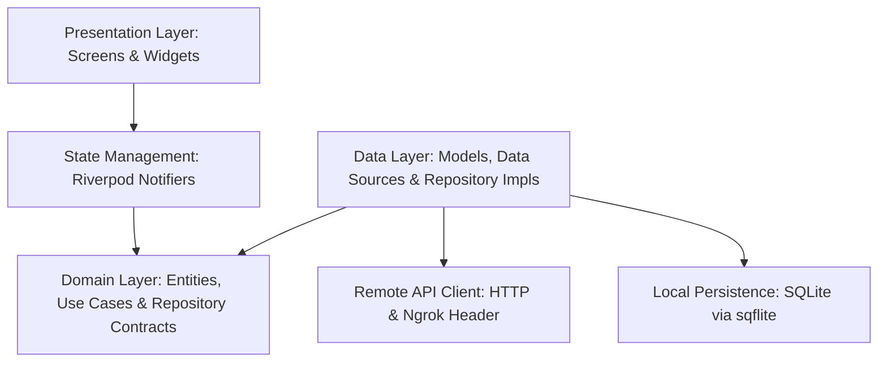

# REBS HRMS — Offline-Capable Employee Workspace

A production-grade, offline-capable mobile HRMS application built with **Flutter**, **Dart null safety**, **Clean Architecture** (Feature-First), and **Riverpod** state management.

Features attendance check-in/out with 200m geofencing, real-time work duration counters, offline action queues with strict FIFO sequential sync and idempotent retries, leave management with live validation, server 422 error mapping, runtime configurable base URLs, and an integrated Node.js mock server with scenario simulation.

---

## Table of Contents
1. [Architecture Overview](#architecture-overview)
2. [Technology Justifications](#technology-justifications)
3. [Features & Capabilities](#features--capabilities)
4. [Project Structure](#project-structure)
5. [Prerequisites & Setup](#prerequisites--setup)
6. [Running the Mock Server](#running-the-mock-server)
7. [Running the Flutter App](#running-the-flutter-app)
8. [Runtime URL & Ngrok Tunnel Setup](#runtime-url--ngrok-tunnel-setup)
9. [Location Simulation Guide](#location-simulation-guide)
10. [Sync Engine & Idempotency Strategy](#sync-engine--idempotency-strategy)
11. [Mock Server Scenarios & Admin Controls](#mock-server-scenarios--admin-controls)
12. [Production Security & Validation Repetitions](#production-security--validation-repetitions)
13. [Required Tests Matrix & Verification](#required-tests-matrix--verification)
14. [APK Deliverables](#apk-deliverables)
15. [Assumptions, Limitations & Disclosures](#assumptions-limitations--disclosures)

---

## Architecture Overview

The project adheres strictly to **Clean Architecture** organized with a **Feature-First** structure:



### Layer Isolation Rules
1. **Domain Layer (`lib/features/*/domain/`)**:
   - **Pure Dart**: Zero imports from Flutter framework (`package:flutter`), SQLite (`sqflite`), or HTTP (`package:http`).
   - Contains pure business entities, repository contracts/interfaces, and domain validators (`GeofenceCalculator`, `AttendanceRules`, `LeaveValidator`).
   - Business date logic uses an injectable `Clock` abstraction with timezone conversion (`Asia/Kolkata`) rather than ambient `DateTime.now()`.
2. **Data Layer (`lib/features/*/data/`)**:
   - Implements repository contracts.
   - Encapsulates SQLite tables via `DatabaseHelper` and REST APIs via `ApiClient`.
   - Handles network-first caching, local pending queue persistence, and JSON serialization.
3. **Presentation Layer (`lib/features/*/presentation/`)**:
   - Reusable widgets, interactive screens, and Riverpod `Notifier` / `AsyncNotifier` providers.
   - Handles optimistic UI updates, permission dialogues, location checks, and error rendering.

---

## Technology Justifications

### 1. State Management: `flutter_riverpod` (v2.6)
- **Compile-Time Safety & Testability**: Riverpod is decoupled from the Flutter widget tree. Providers can be overridden in unit and widget tests without spinning up device harnesses.
- **Predictable State Transitions**: Uses immutable state classes with `copyWith()` and unidirectional data flow.
- **Separation of Concerns**: Business logic lives in `Notifier` classes, separating presentation widgets from application state.

### 2. Local Persistence: SQLite via `sqflite` (v2.4)
- **ACID Guarantees & Monotonic Ordering**: Offline events require strict chronological sequence guarantees. SQLite's auto-incrementing integer primary key provides a strictly monotonically increasing sequence number, ensuring **strict FIFO ordering**.
- **Relational Integrity**: Supports transactional updates when persisting events, updating cache records, and cascading rejection states.
- **Headless Unit Testing**: Leverages `sqflite_common_ffi` with isolated in-memory/temporary databases for sub-second test execution on desktop without an emulator.

### 3. Networking: `http` encapsulated in `ApiClient`
- **Simplicity & Control**: Lightweight, highly stable HTTP library without complex interceptor magic.
- **Unified Header Injection**: Automatically injects `ngrok-skip-browser-warning: true` and `Content-Type: application/json` across all requests.
- **Configurable Base URL**: Dynamically responds to runtime URL changes in `AppConfig` without requiring application rebuilds.
- **Typed Error Mapping**: Automatically maps HTTP 400, 401, 403, 404, 409 (Conflict), 422 (Validation), 500 (Server Error), and network timeouts into strongly typed `AppError` domain models.

---

## Features & Capabilities

- **Employee Dashboard**:
  - Employee profile summary (Alex Mercer, Senior Mobile Engineer, Engineering).
  - Geofence status and office coordinate details.
  - Pull-to-refresh (`RefreshIndicator`) synchronized across all features.
- **Attendance & Geofencing**:
  - Check-in and Check-out workflows with double-tap protection (`isActionInProgress`).
  - Strict 200-meter circular geofence validated via the Haversine formula against office coordinates (`12.971598, 77.594562`).
  - Real-time live duration counter ticking every 1 second when checked in.
  - Recent attendance history displaying the latest records, daily work durations, and status badges.
- **Offline Action Queue & Sync Engine**:
  - Actions saved locally in SQLite when offline with client-generated UUIDv4 `eventId`.
  - Monotonic `sequence` column ensuring strict sequential FIFO replay.
  - Halts execution upon transient network or 5xx server errors to preserve ordering.
  - Automatic retry when device reconnects via `connectivity_plus` stream listener.
  - Dynamic pending actions notification badge on the Dashboard navigation bar.
- **Leave Management**:
  - Available, Used, and Total leave balances for Casual and Sick leave categories.
  - Application form with client-side live validation and date-picker range selection.
  - Start date $\ge$ today (`Asia/Kolkata`), End date $\ge$ Start date, Reason $\ge$ 10 non-whitespace characters, Balance limits, and Overlapping leave detection.
  - Backend 422 field error mapping directly beneath corresponding form input fields.
  - Historical leave request listing with color-coded status chips (`Approved`, `Pending`, `Rejected`).
- **Reviewer Settings & Mock Controls**:
  - Runtime API Base URL configuration with quick presets (`10.0.2.2:3000` for Android emulator, `localhost:3000` for iOS simulator or desktop).
  - Test Connection button to verify connectivity and display latency.
  - Mock Server Scenario switch buttons (`Success`, `Slow`, `Timeout`, `500 Server Error`, `409 Conflict`, `Leave 422 Reject`, and Reset).

---

## Project Structure

```
lib/
├── core/
│   ├── config/          # AppConfig (runtime & compile-time overrides)
│   ├── constants/       # AppConstants & Preferences keys
│   ├── database/        # DatabaseHelper & SQLite schema
│   ├── errors/          # Strongly typed AppError hierarchy
│   ├── network/         # ApiClient (ngrok header, timeouts, error mapping)
│   ├── providers/       # Core Riverpod providers (clock, db, config, data)
│   ├── result/          # Result<T> functional Monad (Success/Failure)
│   ├── services/        # LocationService (geolocator wrapper & mock hooks)
│   ├── theme/           # Material 3 AppTheme design system
│   └── utils/           # Injectable Clock & Timezone helpers
├── features/
│   ├── attendance/      # Attendance domain, data, and presentation
│   ├── dashboard/       # Dashboard screen & consolidated widgets
│   ├── employee/        # Employee profile domain, data, and presentation
│   ├── leave/           # Leave application, validators, cards, and screen
│   ├── settings/        # Runtime configuration & scenario controls
│   └── sync/            # FIFO SyncEngine, Notifier, and PendingSyncBanner
└── main.dart            # App entrypoint & AppShell with NavigationBar
```

---

## Prerequisites & Setup

- **Flutter SDK**: `^3.10.0` or higher (configured with Dart 3 null safety).
- **Node.js**: `v18.0.0` or higher and `npm` (for the mock server).
- **Android Studio / Xcode**: Android emulator or iOS simulator.

Clone the repository and install Flutter dependencies:
```bash
git clone https://github.com/haadiyaa/rebs_hrms_teqbea_task.git
cd rebs_hrms_teqbea_task
flutter pub get
```

---

## Running the Mock Server

The mock server is an Express.js application located in `/mock_server`.

1. Navigate to the mock server folder and install dependencies:
   ```bash
   cd mock_server
   npm install
   ```
2. Start the server:
   ```bash
   node server.js
   ```
   The server runs on `http://localhost:3000`.

### Mock API Endpoints
- `GET /employee/me`: Preconfigured employee profile & office geofence.
- `GET /attendance`: Monthly attendance history and today's record.
- `POST /attendance/events`: Attendance event intake with idempotency check (`eventId`), 200m geofence validation, and sequence enforcement.
- `GET /leave/balance`: Casual and Sick leave balances.
- `GET /leave/requests`: Historical leave applications.
- `POST /leave/requests`: Submit leave request with field-level 422 error validations.
- `POST /__admin/scenario`: Switch scenario (`success`, `slow`, `timeout`, `server_error`, `duplicate_conflict`, `leave_rejection`).
- `POST /__admin/reset`: Reset server in-memory database to default state.

---

## Running the Flutter App

### Option A: Android Emulator
Android emulators connect to the host machine's `localhost` via the special loopback IP `10.0.2.2`:
```bash
flutter run -d emulator-5554 --dart-define=API_BASE_URL=http://10.0.2.2:3000
```

### Option B: iOS Simulator / macOS Desktop
iOS simulators access host `localhost` directly:
```bash
flutter run -d ios --dart-define=API_BASE_URL=http://localhost:3000
```

---

## Runtime URL & Ngrok Tunnel Setup

If testing via **ngrok** (e.g., exposing the mock server to an external network or physical device):

1. Expose the mock server:
   ```bash
   ngrok http 3000
   ```
   Note your forwarding URL (e.g., `https://abcd-1234.ngrok-free.app`).

2. In the Flutter app:
   - Tap the **Settings** tab at the bottom navigation bar.
   - Enter your ngrok URL into the **Backend API Base URL** field and tap the save checkmark.
   - Tap **Test Connection**. A green badge will confirm `Connection successful! (Mock server active)`.
   - *Note*: The app automatically attaches `ngrok-skip-browser-warning: true` to bypass ngrok's intermediate warning page.

---

## Location Simulation & Configurable Office Guide

### 1. In-App Reviewer Location Simulator (Recommended for Reviewers)
To test geofencing on Android emulators or physical devices without external spoofing tools, the application includes an injectable **Location Simulator** (strictly enabled in `kDebugMode`):

1. Launch the app and tap the **Settings** tab.
2. Scroll to the **GPS Location Simulator** section and toggle the switch **ON**.
3. Select any of the reviewer presets:
   - **At Office (0m)**: Coordinates match office center (`12.971598, 77.594562`). Attendance permitted.
   - **Inside Geofence (~150m)**: Computes coordinates using spherical geodesy ($\Delta \text{lat} = \frac{150}{R} \times \frac{180}{\pi}$). Attendance permitted.
   - **Exact Boundary (200m)**: Computes coordinates exactly at the 200.0m boundary line. Attendance permitted.
   - **Outside Geofence (~280m)**: Computes coordinates ~280m north of office. Attendance rejected with clear error message.
   - **Custom Coordinates**: Allows arbitrary latitude and longitude input.
4. When active, a purple banner appears on the **Dashboard** displaying the simulated preset, distance to office, and a one-tap `Real GPS` revert button.

### 2. Configurable Office Coordinates
The office coordinates and radius are dynamically loaded from the backend API:
- Loaded at runtime from `GET /employee/me` and stored in Riverpod `AppConfig`.
- Configurable via the mock server environment (`OFFICE_LAT`, `OFFICE_LNG`, `OFFICE_RADIUS`).
- Configurable at runtime via `POST /__admin/office` or by tapping the **Edit** button in the **Office Geofence & Policies** card on the Settings screen.
- Zero hardcoded coordinates in presentation widgets or business logic.

### 3. Production Security & Server-Side Validations
> [!IMPORTANT]
> The debug location simulator is strictly compiled out in release builds via `kDebugMode` checks. In a production HRMS deployment:
> 1. **Server-Side Geofencing**: The backend server must recalculate the Haversine distance between the submitted event coordinates and the active office location. A client check is purely for UX feedback; the server is the source of truth.
> 2. **Mock Location Detection**: On Android (`Location.isFromMockProvider()` / `Location.isMock()`) and iOS, the app must inspect mock location flags and reject spoofed coordinates.
> 3. **Device Attestation**: Production apps must verify app integrity using **Google Play Integrity API** or **Apple DeviceCheck / App Attest** to prevent tampered APKs.
> 4. **Network & Wi-Fi Corroboration**: Validate corporate Wi-Fi BSSID or enterprise VPN IP alongside GPS telemetry to deter GPS emulation.

### 4. External Location Simulation Options
- **Android Emulator Extended Controls**: `...` > **Location** > Send `12.971598, 77.594562`.
- **ADB Command**: `adb emu geo fix 77.594562 12.971598`
- **Compile-time flags**: `flutter run --dart-define=MOCK_LAT=12.971598 --dart-define=MOCK_LNG=77.594562`

---

## Sync Engine & Idempotency Strategy

```
[Employee Action: Check-In]
           │
           ▼
[Local Persistence in SQLite: sequence=1, status=PENDING, eventId=UUIDv4]
           │
           ├─► [Network Online?] ──NO──► [Keep in SQLite Queue, Show Offline Badge]
           │
          YES
           ▼
[FIFO Sync Engine: Process Order by sequence ASC]
           │
           ├─► [POST /attendance/events with eventId]
           │         │
           │         ├─► [200/201 OK]  ──► Update local event to SYNCED
           │         ├─► [409 Conflict]──► Mark REJECTED, cascade to dependent check-outs
           │         └─► [Timeout/5xx] ──► HALT QUEUE, preserve FIFO, schedule retry
           ▼
[On Reconnect: connectivity_plus auto-triggers queue processing]
```

1. **Strict FIFO Ordering**: All offline events are inserted into `pending_events` table with an `INTEGER PRIMARY KEY AUTOINCREMENT sequence`. When synchronization runs, events are queried with `ORDER BY sequence ASC`.
2. **Client-Generated UUIDv4 Event Identity**: Each event receives a unique UUIDv4 `eventId` at creation. If a sync request times out or is retried after a dropped connection, the identical `eventId` is sent. The server checks its idempotency registry and returns the original record without duplicating attendance.
3. **Queue Halting on Transient Errors**: If any event experiences a timeout, socket failure, or 500 server error, the sync engine **immediately stops** processing subsequent events. This prevents later actions (e.g., check-out) from executing out-of-order before earlier actions (e.g., check-in).
4. **Cascading Rejection Handling**: If a check-in is rejected by the server (HTTP 409), the sync engine immediately marks any subsequent pending check-out for that session as rejected to prevent orphaned states.
5. **Concurrency Mutex**: An internal `_isSyncing` boolean guard prevents race conditions when background connectivity triggers and manual user button presses occur simultaneously.

---

## Mock Server Scenarios & Admin Controls

The Node.js mock backend supports dynamic scenario simulation controllable via the **Settings screen** or REST API:

| Scenario | Server Behavior | App Handling |
| :--- | :--- | :--- |
| `success` | Normal sub-100ms responses with 200/201 | Immediate sync, optimistic UI confirmed |
| `slow` | Injects 3-second delay on all endpoints | Loading spinners, UI remains responsive |
| `timeout` | Injects 12-second delay (exceeds 10s timeout) | `TimeoutError` mapped, queue halted, offline preserved |
| `server_error`| Injects HTTP 500 Internal Server Error | `ServerError` mapped, queue halted, retried later |
| `duplicate_conflict` | Injects HTTP 409 Conflict | `ConflictError` mapped, check-in rejected, cascades |
| `leave_rejection` | Injects HTTP 422 with field validation errors | Field-level errors mapped under input fields |

To reset server state at any time:
```bash
curl -X POST http://localhost:3000/__admin/reset
```

---

## Production Security & Validation Repetitions

While the mobile client performs rigorous validations for immediate user feedback, a production server repeats all business rules independently:

1. **Geofence Validation**: The server re-computes Haversine distance between incoming GPS coordinates and office coordinates to reject spoofed client payloads.
2. **Client vs Server Timestamps**: The server records `received_at` alongside client `timestamp` to detect backdated or forward-dated event spoofing.
3. **Chronological Sequence**: The server enforces that `CHECK_OUT` cannot occur without an existing open `CHECK_IN`.
4. **Duplicate Prevention**: Idempotency keys prevent double submissions; business rules prevent duplicate check-ins within the same calendar day.
5. **Leave Balance & Overlap**: The server calculates working day counts, verifies remaining quota, and locks database rows during transactions to prevent concurrent double-booking of overlapping dates.

---

## Required Tests Matrix & Verification

All 5 assignment-mandated tests and additional architectural unit tests are implemented and passing (52 total tests):

| # | Mandatory Test | Test File | Status |
| :---: | :--- | :--- | :---: |
| **1** | **Check-out without check-in is rejected** | `test/features/attendance/attendance_rules_test.dart` | ✅ PASS |
| **2** | **Repeated submission / retry does not create duplicate attendance** | `test/features/sync/sync_engine_test.dart` | ✅ PASS |
| **3** | **Pending events survive persistence across restart and sync in FIFO order** | `test/features/sync/sync_engine_test.dart` | ✅ PASS |
| **4** | **Overlapping leave dates are rejected** | `test/features/leave/leave_validator_test.dart` | ✅ PASS |
| **5** | **Widget test covering loading, error, or pending-sync state** | `test/widget_test.dart` | ✅ PASS |

To run the full test suite:
```bash
flutter test
```

To run analyzer checks:
```bash
flutter analyze
```

---

## APK Deliverables

A pre-built debug APK configured with Android loopback default is available at:
```
build/app/outputs/flutter-apk/app-debug.apk
```

To build a fresh debug APK at any time:
```bash
flutter build apk --debug --dart-define=API_BASE_URL=http://10.0.2.2:3000
```

---

## Assumptions, Limitations & Disclosures

### Assumptions
- Preconfigured user identity: Employee `EMP-1042` (Alex Mercer).
- Official company timezone: `Asia/Kolkata` (UTC+5:30) handled via the `timezone` package and injectable `Clock`.
- Standard office working day: One check-in and one check-out per calendar date.
- Geofence parameters: 200m circular radius centered at `(12.971598, 77.594562)`.

### Limitations
- Push notifications for leave approval require a live Firebase Cloud Messaging (FCM) project with Google Services credentials (mock polling / pull-to-refresh is provided).
- Mock server runs in-memory; restart clears new attendance records unless persisted to a file.

### AI Assistance Disclosure
In accordance with transparency guidelines, AI assistance (Google DeepMind agent) was utilized during the development of this assignment for boilerplate generation, architecture scaffolding, Haversine formula verification, and test case authoring. All application architecture, domain rules, state management flows, and edge case handling were verified, tested, and validated against assignment specifications.
